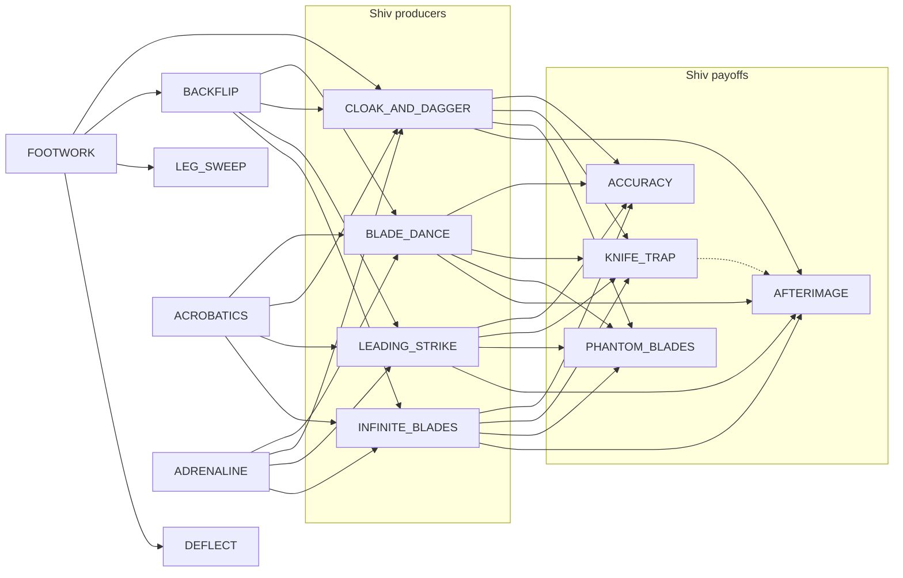

# 小刀白名单关系图（SHIV_RELATIONSHIP_GRAPH）

> **⚠ 已废弃（2026-09-19 判死）** —— 本目录属于离线卡组评价 / DraftSim 调参线，
> 其 `work/` 数据已于 2026-09-20 删除，文中路径多数已失效。
> 入口与适用范围见 [`README.md`](README.md)。当前规范是 [`../../AGENT.md`](../../AGENT.md)。

> 本文件由 `scripts/build-shiv-relationship-graph.py` 确定性生成（标准库，无网络）。
> 只读 owner 已抓取的快照；不修改生产评分、不跑战斗/训练。

## 0. 结论与范围

- 固定 14 个可选节点（whitelist），PANACHE 仅为**白名单外参考**，不进入任何计数。
- 基础牌（ASCENDERS_BANE, DEFEND_SILENT, NEUTRALIZE, STRIKE_SILENT, SURVIVOR）为固定上下文，不是候选节点。
- 四层严格分离，**绝不**合并为单一数值强度。missing 一律记为 unknown，不是 0 或负关系。
- 顶层 `built_at` = `2026-08-18T18:45:19.635000` 指选牌接口快照；配对接口时间分别保留于每条观测。卡面语义来自缓存快照，未声明为当前本地运行时验证。

## 1. 节点（14 whitelist）

| id | name | cost | type | roles |
|---|---|---|---|---|
| BLADE_DANCE | Blade Dance | 1 | Skill | shiv_producer |
| CLOAK_AND_DAGGER | Cloak and Dagger | 1 | Skill | shiv_producer, block |
| LEADING_STRIKE | Leading Strike | 1 | Attack | shiv_producer, attack |
| INFINITE_BLADES | Infinite Blades | 1 | Power | shiv_producer, power, per_turn |
| ACCURACY | Accuracy | 1 | Power | shiv_payoff, per_shiv_damage |
| KNIFE_TRAP | Knife Trap | 2 | Skill | shiv_payoff, exhaust_replay |
| PHANTOM_BLADES | Phantom Blades | 1 | Power | shiv_payoff, retain, first_shiv_per_turn |
| BACKFLIP | Backflip | 1 | Skill | block, draw |
| ACROBATICS | Acrobatics | 1 | Skill | draw, discard |
| ADRENALINE | Adrenaline | 0 | Skill | energy, draw |
| AFTERIMAGE | Afterimage | 1 | Power | played_card_payoff, block_trigger |
| FOOTWORK | Footwork | 1 | Power | dexterity, block_scaling |
| LEG_SWEEP | Leg Sweep | 2 | Skill | block, debuff |
| DEFLECT | Deflect | 0 | Skill | block |

### 外部参考节点

- `PANACHE` (Panache): cost=0, type=Power — outside_whitelist=true, reference_only=true, excluded_from_14_counts=true

## 2. 机制层（Layer 1, mechanism）

全定性有向关系；`effect_units` 各自独立（damage / block / availability），不与社区数值合并。

实线 = `mechanism_supported`；虚线 = `heuristic_hypothesis`（需 runtime 验证）。

### 机制边证据表

| # | source | target | relation_type | effect_units | certainty | runtime? | 证据卡牌 |
|---|---|---|---|---|---|---|---|
| M-001 | BLADE_DANCE | ACCURACY | shiv_generation_feeds_per_shiv_bonus | count of per-Shiv damage bonuses (damage units); no aggregate number invented | mechanism_supported | no | BLADE_DANCE, ACCURACY |
| M-002 | CLOAK_AND_DAGGER | ACCURACY | shiv_generation_feeds_per_shiv_bonus | count of per-Shiv damage bonuses (damage units); no aggregate number invented | mechanism_supported | no | CLOAK_AND_DAGGER, ACCURACY |
| M-003 | LEADING_STRIKE | ACCURACY | shiv_generation_feeds_per_shiv_bonus | count of per-Shiv damage bonuses (damage units); no aggregate number invented | mechanism_supported | no | LEADING_STRIKE, ACCURACY |
| M-004 | INFINITE_BLADES | ACCURACY | shiv_generation_feeds_per_shiv_bonus | count of per-Shiv damage bonuses (damage units); no aggregate number invented | mechanism_supported | no | INFINITE_BLADES, ACCURACY |
| M-005 | BLADE_DANCE | KNIFE_TRAP | shiv_generation_adds_to_exhaust_pile_for_replay | exhausted Shiv count available for replay (count units) | mechanism_supported | no | BLADE_DANCE, KNIFE_TRAP |
| M-006 | CLOAK_AND_DAGGER | KNIFE_TRAP | shiv_generation_adds_to_exhaust_pile_for_replay | exhausted Shiv count available for replay (count units) | mechanism_supported | no | CLOAK_AND_DAGGER, KNIFE_TRAP |
| M-007 | LEADING_STRIKE | KNIFE_TRAP | shiv_generation_adds_to_exhaust_pile_for_replay | exhausted Shiv count available for replay (count units) | mechanism_supported | no | LEADING_STRIKE, KNIFE_TRAP |
| M-008 | INFINITE_BLADES | KNIFE_TRAP | shiv_generation_adds_to_exhaust_pile_for_replay | exhausted Shiv count available for replay (count units) | mechanism_supported | no | INFINITE_BLADES, KNIFE_TRAP |
| M-009 | BLADE_DANCE | PHANTOM_BLADES | shiv_supply_supports_retain_and_first_shiv_bonus | first-Shiv-per-turn bonus trigger count (damage units); Retain is a retention property | mechanism_supported | no | BLADE_DANCE, PHANTOM_BLADES |
| M-010 | CLOAK_AND_DAGGER | PHANTOM_BLADES | shiv_supply_supports_retain_and_first_shiv_bonus | first-Shiv-per-turn bonus trigger count (damage units); Retain is a retention property | mechanism_supported | no | CLOAK_AND_DAGGER, PHANTOM_BLADES |
| M-011 | LEADING_STRIKE | PHANTOM_BLADES | shiv_supply_supports_retain_and_first_shiv_bonus | first-Shiv-per-turn bonus trigger count (damage units); Retain is a retention property | mechanism_supported | no | LEADING_STRIKE, PHANTOM_BLADES |
| M-012 | INFINITE_BLADES | PHANTOM_BLADES | shiv_supply_supports_retain_and_first_shiv_bonus | first-Shiv-per-turn bonus trigger count (damage units); Retain is a retention property | mechanism_supported | no | INFINITE_BLADES, PHANTOM_BLADES |
| M-013 | BLADE_DANCE | AFTERIMAGE | shiv_played_counts_as_played_card | trigger count of triggered Block (block units); one trigger per played Shiv | mechanism_supported | no | BLADE_DANCE, AFTERIMAGE |
| M-014 | CLOAK_AND_DAGGER | AFTERIMAGE | shiv_played_counts_as_played_card | trigger count of triggered Block (block units); one trigger per played Shiv | mechanism_supported | no | CLOAK_AND_DAGGER, AFTERIMAGE |
| M-015 | LEADING_STRIKE | AFTERIMAGE | shiv_played_counts_as_played_card | trigger count of triggered Block (block units); one trigger per played Shiv | mechanism_supported | no | LEADING_STRIKE, AFTERIMAGE |
| M-016 | INFINITE_BLADES | AFTERIMAGE | shiv_played_counts_as_played_card | trigger count of triggered Block (block units); one trigger per played Shiv | mechanism_supported | no | INFINITE_BLADES, AFTERIMAGE |
| M-017 | FOOTWORK | CLOAK_AND_DAGGER | dexterity_scales_normal_block | block units per Dexterity (normal Block sensitivity) | mechanism_supported | no | FOOTWORK, CLOAK_AND_DAGGER |
| M-018 | FOOTWORK | BACKFLIP | dexterity_scales_normal_block | block units per Dexterity (normal Block sensitivity) | mechanism_supported | no | FOOTWORK, BACKFLIP |
| M-019 | FOOTWORK | LEG_SWEEP | dexterity_scales_normal_block | block units per Dexterity (normal Block sensitivity) | mechanism_supported | no | FOOTWORK, LEG_SWEEP |
| M-020 | FOOTWORK | DEFLECT | dexterity_scales_normal_block | block units per Dexterity (normal Block sensitivity) | mechanism_supported | no | FOOTWORK, DEFLECT |
| M-021 | ACROBATICS | BLADE_DANCE | enables_component_availability | availability / consistency (NOT damage or block units) | mechanism_supported | no | ACROBATICS, BLADE_DANCE |
| M-022 | ACROBATICS | CLOAK_AND_DAGGER | enables_component_availability | availability / consistency (NOT damage or block units) | mechanism_supported | no | ACROBATICS, CLOAK_AND_DAGGER |
| M-023 | ACROBATICS | LEADING_STRIKE | enables_component_availability | availability / consistency (NOT damage or block units) | mechanism_supported | no | ACROBATICS, LEADING_STRIKE |
| M-024 | ACROBATICS | INFINITE_BLADES | enables_component_availability | availability / consistency (NOT damage or block units) | mechanism_supported | no | ACROBATICS, INFINITE_BLADES |
| M-025 | BACKFLIP | BLADE_DANCE | enables_component_availability | availability / consistency (NOT damage or block units) | mechanism_supported | no | BACKFLIP, BLADE_DANCE |
| M-026 | BACKFLIP | CLOAK_AND_DAGGER | enables_component_availability | availability / consistency (NOT damage or block units) | mechanism_supported | no | BACKFLIP, CLOAK_AND_DAGGER |
| M-027 | BACKFLIP | LEADING_STRIKE | enables_component_availability | availability / consistency (NOT damage or block units) | mechanism_supported | no | BACKFLIP, LEADING_STRIKE |
| M-028 | BACKFLIP | INFINITE_BLADES | enables_component_availability | availability / consistency (NOT damage or block units) | mechanism_supported | no | BACKFLIP, INFINITE_BLADES |
| M-029 | ADRENALINE | BLADE_DANCE | enables_component_availability | availability / consistency (NOT damage or block units) | mechanism_supported | no | ADRENALINE, BLADE_DANCE |
| M-030 | ADRENALINE | CLOAK_AND_DAGGER | enables_component_availability | availability / consistency (NOT damage or block units) | mechanism_supported | no | ADRENALINE, CLOAK_AND_DAGGER |
| M-031 | ADRENALINE | LEADING_STRIKE | enables_component_availability | availability / consistency (NOT damage or block units) | mechanism_supported | no | ADRENALINE, LEADING_STRIKE |
| M-032 | ADRENALINE | INFINITE_BLADES | enables_component_availability | availability / consistency (NOT damage or block units) | mechanism_supported | no | ADRENALINE, INFINITE_BLADES |
| M-033 | KNIFE_TRAP | AFTERIMAGE | replay_may_count_as_played_card | play-event count (block units if and only if replay counts as played) | heuristic_hypothesis | yes | KNIFE_TRAP, AFTERIMAGE |

### 通用规则

- **every_played_card_triggers_afterimage** (`R-001`): 通用规则：每打出一张牌（包括 Shiv）都触发 AFTERIMAGE 的『每当打出一张牌获得 Block』。因此无需为全部 14 节点建立稠密团，只保留 4 张生成牌的 representative 边并在此声明通用规则。
- **draw_energy_component_availability** (`R-002`): 抽牌/能量经由牌组构成影响任意组件的可用性，属于条件使能；本层只对 4 张生成牌枚举 representative 边。
- **any_shiv_producer_feeds_payoffs** (`R-003`): 任意 Shiv 生成牌都可作为 ACCURACY / KNIFE_TRAP / PHANTOM_BLADES / AFTERIMAGE 的供给；本层只枚举白名单内 4 张生成牌。

## 3. 社区 draft 层（Layer 2, community_draft）

方向约定：`source = 已持有 context`，`target = 被提供 candidate`（有向抓取方向，不可对称化）。

| # | source(held) | target(offered) | pref | pref_base | lift | offers | picks | winrate | built_at |
|---|---|---|---|---|---|---|---|---|---|
| D-001 | ACCURACY | BLADE_DANCE | 0.5683 | 0.3435 | 1.6546 | 22668 | 12890 | 0.4903 | 2026-08-18T18:45:19.635000 |
| D-002 | ACCURACY | CLOAK_AND_DAGGER | 0.4870 | 0.2977 | 1.6358 | 22491 | 10959 | 0.4750 | 2026-08-18T18:45:19.635000 |
| D-003 | ACCURACY | INFINITE_BLADES | 0.5062 | 0.3087 | 1.6399 | 12143 | 6153 | 0.5176 | 2026-08-18T18:45:19.635000 |
| D-004 | ACCURACY | KNIFE_TRAP | 0.7237 | 0.4096 | 1.7669 | 8509 | 6167 | 0.6264 | 2026-08-18T18:45:19.635000 |
| D-005 | ACCURACY | LEADING_STRIKE | 0.4043 | 0.2534 | 1.5957 | 23436 | 9480 | 0.4427 | 2026-08-18T18:45:19.635000 |
| D-006 | ACCURACY | PHANTOM_BLADES | 0.4176 | 0.2495 | 1.6734 | 8911 | 3726 | 0.5038 | 2026-08-18T18:45:19.635000 |
| D-007 | INFINITE_BLADES | ACCURACY | 0.6644 | 0.3882 | 1.7114 | 10909 | 7256 | 0.5305 | 2026-08-18T18:45:19.635000 |
| D-008 | INFINITE_BLADES | KNIFE_TRAP | 0.6962 | 0.4096 | 1.6998 | 7727 | 5388 | 0.5950 | 2026-08-18T18:45:19.635000 |
| D-009 | INFINITE_BLADES | PHANTOM_BLADES | 0.4723 | 0.2495 | 1.8929 | 7764 | 3674 | 0.4984 | 2026-08-18T18:45:19.635000 |
| D-010 | KNIFE_TRAP | ACCURACY | 0.6576 | 0.3882 | 1.6940 | 3283 | 2167 | 0.5939 | 2026-08-18T18:45:19.635000 |
| D-011 | KNIFE_TRAP | BLADE_DANCE | 0.6135 | 0.3435 | 1.7862 | 6275 | 3858 | 0.5358 | 2026-08-18T18:45:19.635000 |
| D-012 | KNIFE_TRAP | CLOAK_AND_DAGGER | 0.4940 | 0.2977 | 1.6592 | 6616 | 3274 | 0.5098 | 2026-08-18T18:45:19.635000 |
| D-013 | KNIFE_TRAP | INFINITE_BLADES | 0.5127 | 0.3087 | 1.6609 | 3575 | 1839 | 0.5601 | 2026-08-18T18:45:19.635000 |
| D-014 | KNIFE_TRAP | LEADING_STRIKE | 0.4131 | 0.2534 | 1.6305 | 6616 | 2738 | 0.4711 | 2026-08-18T18:45:19.635000 |
| D-015 | PHANTOM_BLADES | ACCURACY | 0.6409 | 0.3882 | 1.6510 | 6276 | 4030 | 0.5213 | 2026-08-18T18:45:19.635000 |
| D-016 | PHANTOM_BLADES | BLADE_DANCE | 0.4817 | 0.3435 | 1.4025 | 12243 | 5902 | 0.4531 | 2026-08-18T18:45:19.635000 |
| D-017 | PHANTOM_BLADES | CLOAK_AND_DAGGER | 0.4453 | 0.2977 | 1.4956 | 12432 | 5540 | 0.4581 | 2026-08-18T18:45:19.635000 |
| D-018 | PHANTOM_BLADES | INFINITE_BLADES | 0.4689 | 0.3087 | 1.5189 | 6614 | 3106 | 0.5071 | 2026-08-18T18:45:19.635000 |
| D-019 | PHANTOM_BLADES | KNIFE_TRAP | 0.7070 | 0.4096 | 1.7261 | 4610 | 3268 | 0.6047 | 2026-08-18T18:45:19.635000 |
| D-020 | PHANTOM_BLADES | LEADING_STRIKE | 0.3517 | 0.2534 | 1.3882 | 13192 | 4643 | 0.4264 | 2026-08-18T18:45:19.635000 |

- 可能的有向对：182；观测边：20；unknown：162。

## 4. 社区 pairings 层（Layer 3, community_pairings）

无向去重：`key = sorted(a,b)`；保留两个方向的 `conf`/`conf_rev`，反向不一致记 conflict，不覆盖、不平均。

| # | a | b | co | conf(a→b) | conf(b→a) | npmi | winrate | conflict |
|---|---|---|---|---|---|---|---|---|
| P-001 | ACCURACY | ADRENALINE | 14281 | 0.2042 | 0.3116 | 0.3796 | 0.6271 | no |
| P-002 | ACCURACY | AFTERIMAGE | 14698 | 0.2102 | 0.3720 | 0.4222 | 0.6584 | no |
| P-003 | ACCURACY | BLADE_DANCE | 43529 | 0.6225 | 0.4524 | 0.6189 | 0.5019 | no |
| P-004 | ACCURACY | CLOAK_AND_DAGGER | 40590 | 0.5804 | 0.4451 | 0.6013 | 0.5041 | no |
| P-005 | ACCURACY | DEFLECT | 20193 | 0.2888 | 0.3032 | 0.4050 | 0.4973 | no |
| P-006 | ACCURACY | FOOTWORK | 22016 | 0.3148 | 0.2965 | 0.4082 | 0.5394 | no |
| P-007 | ACCURACY | INFINITE_BLADES | 29183 | 0.4173 | 0.4888 | 0.5732 | 0.5380 | no |
| P-008 | ACCURACY | KNIFE_TRAP | 17377 | 0.2485 | 0.5522 | 0.5319 | 0.6354 | no |
| P-009 | ACCURACY | LEADING_STRIKE | 38118 | 0.5451 | 0.4613 | 0.6008 | 0.4875 | no |
| P-010 | ACCURACY | PHANTOM_BLADES | 19263 | 0.2755 | 0.5033 | 0.5228 | 0.5351 | no |
| P-011 | ACROBATICS | ADRENALINE | 16337 | 0.2160 | 0.3565 | 0.4045 | 0.6483 | no |
| P-012 | ACROBATICS | AFTERIMAGE | 13543 | 0.1791 | 0.3428 | 0.3789 | 0.6623 | no |
| P-013 | ACROBATICS | BACKFLIP | 33530 | 0.4433 | 0.3325 | 0.4661 | 0.5432 | no |
| P-014 | ACROBATICS | FOOTWORK | 24253 | 0.3207 | 0.3266 | 0.4230 | 0.5555 | no |
| P-015 | ACROBATICS | LEG_SWEEP | 12527 | 0.1656 | 0.3168 | 0.3552 | 0.5402 | no |
| P-016 | ADRENALINE | BACKFLIP | 20391 | 0.4450 | 0.2022 | 0.4102 | 0.6085 | no |
| P-017 | ADRENALINE | BLADE_DANCE | 17779 | 0.3880 | 0.1848 | 0.3756 | 0.5878 | no |
| P-018 | ADRENALINE | CLOAK_AND_DAGGER | 17114 | 0.3734 | 0.1877 | 0.3758 | 0.5840 | no |
| P-019 | ADRENALINE | FOOTWORK | 15227 | 0.3323 | 0.2051 | 0.3861 | 0.6107 | no |
| P-020 | AFTERIMAGE | BACKFLIP | 17621 | 0.4460 | 0.1747 | 0.3966 | 0.6248 | no |
| P-021 | AFTERIMAGE | BLADE_DANCE | 17856 | 0.4519 | 0.1856 | 0.4122 | 0.6130 | no |
| P-022 | AFTERIMAGE | CLOAK_AND_DAGGER | 17052 | 0.4316 | 0.1870 | 0.4095 | 0.6112 | no |
| P-023 | AFTERIMAGE | FOOTWORK | 13880 | 0.3513 | 0.1869 | 0.3906 | 0.6269 | no |
| P-024 | AFTERIMAGE | INFINITE_BLADES | 12299 | 0.3113 | 0.2060 | 0.4014 | 0.6433 | no |
| P-025 | AFTERIMAGE | LEADING_STRIKE | 15388 | 0.3895 | 0.1862 | 0.3989 | 0.5947 | no |
| P-026 | BACKFLIP | BLADE_DANCE | 36288 | 0.3598 | 0.3771 | 0.4305 | 0.4752 | no |
| P-027 | BACKFLIP | CLOAK_AND_DAGGER | 35252 | 0.3495 | 0.3865 | 0.4339 | 0.4761 | no |
| P-028 | BACKFLIP | DEFLECT | 28040 | 0.2780 | 0.4210 | 0.4303 | 0.4720 | no |
| P-029 | BACKFLIP | FOOTWORK | 33980 | 0.3369 | 0.4576 | 0.4767 | 0.5204 | no |
| P-030 | BACKFLIP | LEADING_STRIKE | 31735 | 0.3147 | 0.3841 | 0.4197 | 0.4568 | no |
| P-031 | BACKFLIP | LEG_SWEEP | 17426 | 0.1728 | 0.4407 | 0.3928 | 0.5084 | no |
| P-032 | BLADE_DANCE | CLOAK_AND_DAGGER | 49554 | 0.5150 | 0.5434 | 0.6015 | 0.4481 | no |
| P-033 | BLADE_DANCE | DEFLECT | 26360 | 0.2739 | 0.3958 | 0.4195 | 0.4423 | no |
| P-034 | BLADE_DANCE | INFINITE_BLADES | 34448 | 0.3580 | 0.5770 | 0.5569 | 0.4873 | no |
| P-035 | BLADE_DANCE | KNIFE_TRAP | 20945 | 0.2177 | 0.6655 | 0.5238 | 0.5862 | no |
| P-036 | BLADE_DANCE | LEADING_STRIKE | 45931 | 0.4773 | 0.5559 | 0.5945 | 0.4318 | no |
| P-037 | BLADE_DANCE | PHANTOM_BLADES | 22691 | 0.2358 | 0.5928 | 0.5052 | 0.4821 | no |
| P-038 | CLOAK_AND_DAGGER | DEFLECT | 26061 | 0.2858 | 0.3913 | 0.4292 | 0.4411 | no |
| P-039 | CLOAK_AND_DAGGER | FOOTWORK | 27276 | 0.2991 | 0.3674 | 0.4177 | 0.4876 | no |
| P-040 | CLOAK_AND_DAGGER | INFINITE_BLADES | 32701 | 0.3586 | 0.5477 | 0.5493 | 0.4871 | no |
| P-041 | CLOAK_AND_DAGGER | KNIFE_TRAP | 19215 | 0.2107 | 0.6106 | 0.5050 | 0.5815 | no |
| P-042 | CLOAK_AND_DAGGER | LEADING_STRIKE | 43872 | 0.4811 | 0.5310 | 0.5886 | 0.4338 | no |
| P-043 | CLOAK_AND_DAGGER | PHANTOM_BLADES | 22177 | 0.2432 | 0.5794 | 0.5100 | 0.4878 | no |
| P-044 | DEFLECT | FOOTWORK | 21534 | 0.3234 | 0.2900 | 0.4126 | 0.4861 | no |
| P-045 | DEFLECT | LEADING_STRIKE | 23559 | 0.3538 | 0.2851 | 0.4177 | 0.4308 | no |
| P-046 | FOOTWORK | LEG_SWEEP | 14659 | 0.1974 | 0.3707 | 0.4076 | 0.5212 | no |
| P-047 | INFINITE_BLADES | KNIFE_TRAP | 14148 | 0.2370 | 0.4496 | 0.4967 | 0.6073 | no |
| P-048 | INFINITE_BLADES | LEADING_STRIKE | 29829 | 0.4996 | 0.3610 | 0.5375 | 0.4708 | no |
| P-049 | INFINITE_BLADES | PHANTOM_BLADES | 16228 | 0.2718 | 0.4240 | 0.4989 | 0.5285 | no |
| P-050 | KNIFE_TRAP | LEADING_STRIKE | 17768 | 0.5646 | 0.2150 | 0.5005 | 0.5615 | no |
| P-051 | KNIFE_TRAP | PHANTOM_BLADES | 8778 | 0.2789 | 0.2293 | 0.4419 | 0.6129 | no |
| P-052 | LEADING_STRIKE | PHANTOM_BLADES | 20681 | 0.2503 | 0.5403 | 0.5084 | 0.4730 | no |

- 可能的无向对：91；去重后观测边：52；unknown：39；conflict：0。

## 5. 外部参考层（Layer 4, external_reference）

| # | source(held) | target | lift | offers | picks | pref | built_at |
|---|---|---|---|---|---|---|---|
| X-001 | ACCURACY | PANACHE | 2.1143 | 1022 | 172 | 0.1657 | 2026-08-18T18:45:19.635000 |
| X-002 | BLADE_DANCE | PANACHE | 1.9676 | 2248 | 349 | 0.1542 | 2026-08-18T18:45:19.635000 |

PANACHE 明确在白名单外；外部边不进入 14 节点计数。

## 6. 示例：ACCURACY

机制支撑：
- BLADE_DANCE -> ACCURACY (shiv_generation_feeds_per_shiv_bonus, mechanism_supported)
- CLOAK_AND_DAGGER -> ACCURACY (shiv_generation_feeds_per_shiv_bonus, mechanism_supported)
- LEADING_STRIKE -> ACCURACY (shiv_generation_feeds_per_shiv_bonus, mechanism_supported)
- INFINITE_BLADES -> ACCURACY (shiv_generation_feeds_per_shiv_bonus, mechanism_supported)

社区方向区分（received vs outgoing，不可合并）：

| 方向 | 含义 | edges |
|---|---|---|
| received (as candidate) | 他牌 held -> offered ACCURACY | INFINITE_BLADES(lift=1.7114), KNIFE_TRAP(lift=1.6940), PHANTOM_BLADES(lift=1.6510) |
| outgoing (as context) | ACCURACY held -> offered 他牌 | BLADE_DANCE(lift=1.6546), CLOAK_AND_DAGGER(lift=1.6358), INFINITE_BLADES(lift=1.6399), KNIFE_TRAP(lift=1.7669), LEADING_STRIKE(lift=1.5957), PHANTOM_BLADES(lift=1.6734) |

## 7. 来源与溯源

| path | sha256 (前 16) |
|---|---|
| work/spire-codex/cards/cards.json | 96e5422f839d6a6a |
| work/relationship-audit/draft-recs-BLADE_DANCE.json | ad08087f5a09986c |
| work/relationship-audit/draft-recs-CLOAK_AND_DAGGER.json | 18df7cb7eeed4598 |
| work/relationship-audit/draft-recs-LEADING_STRIKE.json | 7a31fb50136a2d18 |
| work/relationship-audit/draft-recs-INFINITE_BLADES.json | ba3a44724c6e3c76 |
| work/relationship-audit/draft-accuracy.json | f802463bd319ff7a |
| work/relationship-audit/draft-recs-KNIFE_TRAP.json | 7222ed59e48ed778 |
| work/relationship-audit/draft-recs-PHANTOM_BLADES.json | 0551e1cd9956eb52 |
| work/relationship-audit/draft-recs-BACKFLIP.json | d73f588b8a65fbef |
| work/relationship-audit/draft-recs-ACROBATICS.json | 5274a104de91e00a |
| work/relationship-audit/draft-recs-ADRENALINE.json | de32b1f951894d46 |
| work/relationship-audit/draft-recs-AFTERIMAGE.json | bc901d992ef6ad64 |
| work/relationship-audit/draft-recs-FOOTWORK.json | 88c0c00339ad75a0 |
| work/relationship-audit/draft-recs-LEG_SWEEP.json | 34b3c9ae99f65cf7 |
| work/relationship-audit/draft-recs-DEFLECT.json | 992f1b655cd7392b |
| work/relationship-audit/pairings-BLADE_DANCE.json | 27398a389c1f69c4 |
| work/relationship-audit/pairings-CLOAK_AND_DAGGER.json | d2a9ece41cb8bfe5 |
| work/relationship-audit/pairings-LEADING_STRIKE.json | e9aa56ddc215095f |
| work/relationship-audit/pairings-INFINITE_BLADES.json | df8c9d533e89afee |
| work/relationship-audit/pair-accuracy.json | 24ebd28bf94e4d69 |
| work/relationship-audit/pairings-KNIFE_TRAP.json | 6c4cfcf4b106c45e |
| work/relationship-audit/pairings-PHANTOM_BLADES.json | fb406c9ea8c35511 |
| work/relationship-audit/pairings-BACKFLIP.json | 24c5dc34cf75517f |
| work/relationship-audit/pairings-ACROBATICS.json | 5c7448968d934a3c |
| work/relationship-audit/pairings-ADRENALINE.json | 0b2d5de6ea84b5df |
| work/relationship-audit/pairings-AFTERIMAGE.json | 0b9062ad5cc361e9 |
| work/relationship-audit/pairings-FOOTWORK.json | 1e4892dc1ce91c21 |
| work/relationship-audit/pairings-LEG_SWEEP.json | 7e82310ff1312444 |
| work/relationship-audit/pairings-DEFLECT.json | d417b70f861f04e2 |
| work/relationship-audit/coverage-summary.json | 4c2a77bc785c6017 |
| work/relationship-audit/source-tree.json | 468f7e09b9b23106 |
| work/relationship-audit/openapi.json | 071d62df92c6590f |

- owner 快照目录：`work/relationship-audit/`；卡表缓存：`work/spire-codex/cards/cards.json`。
- 上游源码树 sha：`683e82fc6fbb73d1230ebcdd0302e38c960b2186`（当前公开源，仅作代理，不一定等于 8/18 出数版本）。
- 快照未保存完整请求 URL，故不臆造 URL。

## 8. 使用限制

- 卡面文字与 cost 取自 work/spire-codex/cards/cards.json 缓存快照，未声明为当前本地运行时验证版本。
- 社区各接口的 built_at 分别保留于观测中；种群可能跨版本/模式/人数混合，时间戳只代表池子生成时刻，不代表样本时间跨度。
- draft 层方向为『持有 context -> 被提供 candidate』；这是有向抓取观测，不能当作对称图使用。
- 缺失的 draft 有向边 (162/182) 与 pairings 无向边 (39/91) 均记为 unknown，不能记作 0 或负关系。
- 机制层为定性规则，effect_units 各自独立（damage / block / availability），绝不合并为单一数值强度。
- KNIFE_TRAP -> AFTERIMAGE 的『重放是否计为打出』未由卡面文字确认，标记为需要 runtime 验证的假设。
- 本图不是可用于评分的 prior/model，也不从原始 winrate 给出任何评分建议。
- PANACHE 仅作外部参考示例，明确在白名单之外，且不进入 14 节点任何计数。

## 9. 生成与验证摘要

- generator: `scripts/build-shiv-relationship-graph.py`（标准库、确定性，revision=1）。
- checks_run: 20；errors: 0。
- 自检覆盖：节点 ID、方向、计数 20/52、原始数值 roundtrip、去重 conflict 标记、数值范围、机制边无悬空、missing 列表互斥且完整、source SHA。
